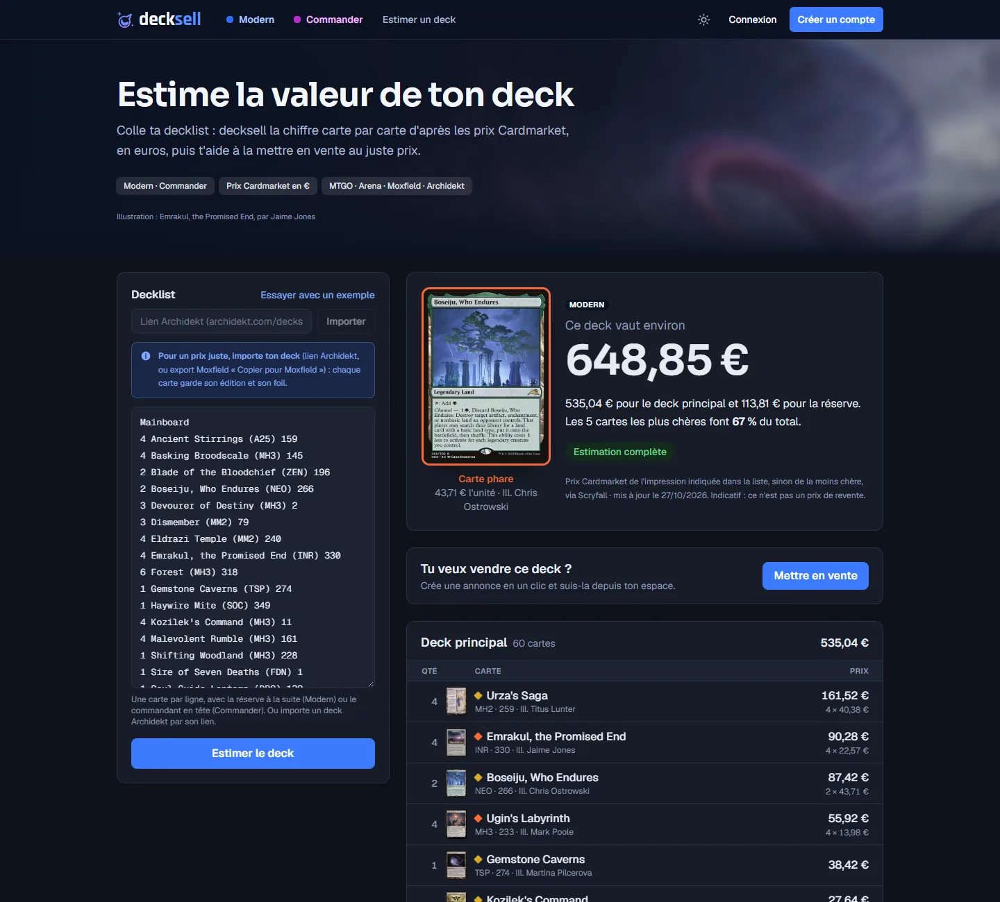

<div align="center">

# decksell

**Estime, vends et achète des decks Magic: The Gathering Modern complets, au juste prix.**

Colle ta decklist, decksell la chiffre carte par carte d'après les prix Cardmarket en euros,
puis t'aide à la mettre en vente et à suivre la vente.


</div>

## Pourquoi decksell

Les outils existants savent construire et estimer des decks (Moxfield, MTGGoldfish) ou vendre des cartes à l'unité
(Cardmarket). decksell part de **la decklist entière** et va jusqu'à **la vente du deck complet entre joueurs**, sans
le découper carte par carte. L'estimation donne au vendeur et à l'acheteur le même point de départ.

## Fonctionnalités

### Estimation d'un deck

- **Coller sa liste telle quelle** : formats MTGO, Arena, Moxfield et MTGGoldfish, avec la réserve à la suite.
- **Valeur carte par carte** en euros, triée par prix, avec rareté, édition, illustrateur et aperçu de la carte.
- **Carte phare** mise en avant et part des 5 cartes les plus chères dans le total.
- **Rien n'est compté en silence** : une carte introuvable ou sans prix est signalée, laissée hors du total, et le
  vendeur peut indiquer son propre prix.



### Place de marché

- **Index des decks en vente** avec l'illustration de la carte phare, le prix demandé et l'écart avec la valeur estimée.
- **Filtres** par couleurs (cumulables : un deck doit contenir toutes les couleurs choisies) et par archétype
  (Burn, Reanimator, Amulet Titan…), partageables par leur adresse.
- **Page de chaque deck** : la liste aux prix du jour, l'état des cartes, la part de cartes en français et en anglais,
  le profil du vendeur.

### Espace vendeur

- **Mise en vente depuis l'estimation**, en un clic : prix, état, couleurs, archétype, langue, description.
- **Suivi des annonces** : en vente, réservé, vendu (avec la date et le prix de vente), retiré.
- **Vue détaillée de chaque deck** et rappel de ce qu'il reste à compléter.
- **Profil** : pseudo, photo, liens Moxfield et Archidekt.

## Comment les prix sont calculés

| Règle | Détail |
|---|---|
| Source | Prix Cardmarket en euros, via les données publiques de [Scryfall](https://scryfall.com) |
| Impression retenue | L'impression **non-foil la moins chère** de chaque carte |
| Fraîcheur | Prix réimportés chaque jour ; leur date est affichée avec chaque estimation |
| Cartes sans prix | Signalées et exclues du total ; le vendeur peut saisir un prix |
| Statut | Indicatif : c'est un repère, pas une offre de rachat |

## Stack technique

- **[Next.js 16](https://nextjs.org)** (App Router, Server Actions, Cache Components, Proxy) et **React 19**
- **[Supabase](https://supabase.com)** : Postgres (cartes, annonces, profils), Auth (email et mot de passe), Storage
  (photos de profil)
- **Tailwind CSS 4**, polices Geist et Sora
- **Vercel** pour l'hébergement, déployé à chaque push sur `main`
- Tests avec le lanceur intégré de Node (`node --test`)

## Démarrer en local

### Prérequis

- Node.js 24 (recommandé) : les tests et les scripts importent directement des fichiers TypeScript
- Un projet [Supabase](https://supabase.com) (l'offre gratuite suffit)

### Installation

```bash
git clone https://github.com/AntoineWeis/decksell.git
cd decksell
npm install
```

### Configuration

1. Copie `.env.example` vers `.env.local` et renseigne les clés de ton projet Supabase :

   | Variable | Où la trouver | Usage |
   |---|---|---|
   | `NEXT_PUBLIC_SUPABASE_URL` | Supabase › Connect | Adresse du projet |
   | `NEXT_PUBLIC_SUPABASE_PUBLISHABLE_KEY` | Settings › API Keys | Clé publique (navigateur) |
   | `SUPABASE_SECRET_KEY` | Settings › API Keys | Clé secrète, **serveur uniquement** |
   | `RESEND_API_KEY` | resend.com › API Keys | Emails de nouveau message (facultatif) |
   | `EMAIL_FROM` | Adresse d'un domaine vérifié chez Resend | Expéditeur, ex. `decksell <notifications@ton-domaine.fr>` |

2. Dans Supabase › **SQL Editor**, exécute tout le fichier [`supabase/schema.sql`](supabase/schema.sql). Il est
   réexécutable sans risque après chaque mise à jour.
3. Dans Supabase › **Authentication › URL Configuration**, mets `http://localhost:3000` en Site URL et ajoute
   `http://localhost:3000/**` aux Redirect URLs.
4. Importe les cartes et les prix depuis Scryfall (plusieurs minutes pour l'import complet) :

   ```bash
   npm run import:scryfall
   ```

### Import quotidien des prix

Le workflow [`.github/workflows/import-prix.yml`](.github/workflows/import-prix.yml) relance l'import chaque jour à
10 h 23 UTC, après la mise à jour du fichier Scryfall. Pour l'activer sur ton dépôt, ajoute deux secrets dans
GitHub › **Settings › Secrets and variables › Actions** : `NEXT_PUBLIC_SUPABASE_URL` et `SUPABASE_SECRET_KEY`.
Tu peux aussi le lancer à la main depuis l'onglet **Actions** (bouton *Run workflow*).

### Lancer

```bash
npm run dev
```

Le site est alors disponible sur [http://localhost:3000](http://localhost:3000).

## Scripts

| Commande | Rôle |
|---|---|
| `npm run dev` | Serveur de développement |
| `npm run build` / `npm start` | Build et serveur de production |
| `npm test` | Tests (lecteur de decklists, calcul des prix, saisies) |
| `npm run lint` | Vérification ESLint |
| `npm run import:scryfall` | Import des cartes et des prix Scryfall dans Supabase (`-- --limit 2000` pour un essai, `-- --force` pour réimporter le même fichier) |
| `npm run check:supabase` | Test de connexion à Supabase |
| `npm run estimate -- deck.txt` | Estimation d'une decklist en ligne de commande |

## Structure du projet

```
src/
├── app/                 Pages et actions serveur
│   ├── page.tsx         Accueil
│   ├── estimer/         Estimation d'un deck
│   ├── decks/           Index des decks en vente et page de chaque deck
│   ├── espace/          Espace vendeur : annonces, vue détaillée, profil
│   ├── connexion/       Connexion
│   └── inscription/     Inscription
├── components/          Composants d'interface (tableau de cartes, filtres, formulaires…)
├── lib/                 Logique métier : lecture des decklists, calcul des prix, accès aux données
└── proxy.ts             Rafraîchissement de la session Supabase
supabase/schema.sql      Schéma complet de la base (tables, règles RLS, archétypes)
.github/workflows/       Import quotidien des prix (GitHub Actions)
scripts/                 Import Scryfall, estimation en ligne de commande, test de connexion
tests/                   Tests unitaires
PRODUCT.md / DESIGN.md   Fiche produit et système de design
```

## Sécurité

- **Règles RLS** sur toutes les tables : un membre ne lit et ne modifie que son profil, ses annonces et ses photos.
- **La clé secrète Supabase ne quitte jamais le serveur** (modules `server-only`) ; la table des cartes n'est pas
  lisible avec la clé publique.
- **Chaque action serveur revérifie** le membre connecté et valide toutes les saisies.
- **L'index public** ne renvoie que les annonces en vente ou réservées, et seulement leurs colonnes publiques.

## Feuille de route

- [ ] Prise de contact entre acheteur et vendeur
- [x] Import automatique et quotidien des prix
- [x] Mot de passe oublié
- [ ] Fourchette de prix de revente
- [ ] Reconnaissance automatique de l'archétype d'une liste

## Mentions

Données de cartes, images et symboles de mana : [Scryfall](https://scryfall.com). Prix en euros issus de
Cardmarket, indicatifs et datés.

decksell est un contenu de fans non officiel, non approuvé par Wizards of the Coast. Portions des éléments utilisés :
propriété de Wizards of the Coast. ©Wizards of the Coast LLC.
